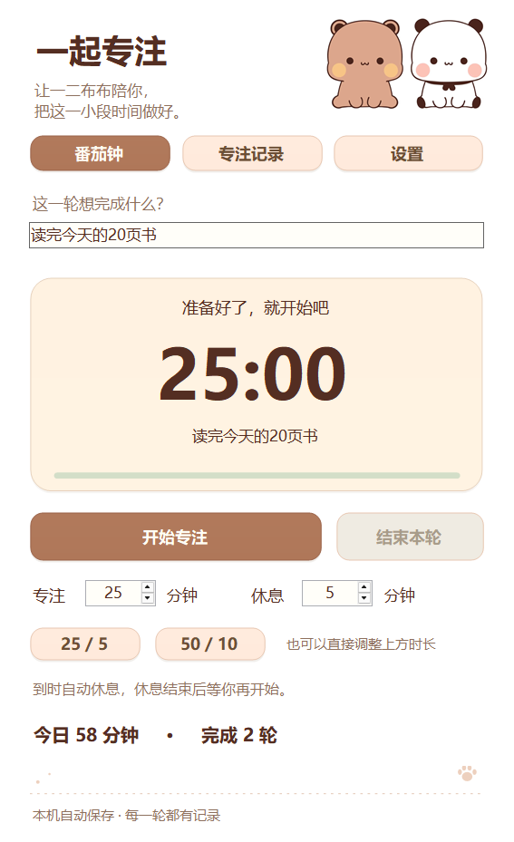

# 一二布布桌宠

给电脑安排两只小同事：你敲键盘，一二跟着敲；你点鼠标，布布也开始忙。

**全部功能免费 · Windows 电脑本地版 · 无需注册 · 打赏自愿**

[下载 Windows 64 位版](https://github.com/wenjieguan336-droid/yier-bubu-desktop-pet/releases/latest/download/YierBubu-DesktopPet-Windows-x64.zip) · [查看全部版本](https://github.com/wenjieguan336-droid/yier-bubu-desktop-pet/releases) · [反馈问题](https://github.com/wenjieguan336-droid/yier-bubu-desktop-pet/issues)


## 可以做什么

- **键鼠同步**：一二的手掌跟随键位，按下的键单独高亮；布布响应鼠标左键、右键、中键和滚轮。
- **番茄钟**：写下本轮任务，选择 25/5、50/10 或自定义时长，支持暂停和继续。
- **专注记录**：回看任务名称、实际专注时长和起止时间，支持今天、近 7 天和全部记录。
- **今日卡**：写下三件小事和每日专注目标，完成后自己勾选。
- **专注花园**：每累计实际专注 3 小时，收集一盆小花，持续积累，不会枯萎。
- **喝水提醒**：间隔自己设置，由角色气泡提醒。
- **个性设置**：5 种亮键颜色、5 档大小、3 档动作幅度，可选待机呼吸、小表情和自动互动。

桌上的闹钟、本子、水杯和盆栽，分别可以点击进入对应功能。

<details>
<summary>看看番茄钟界面（示例任务与数据）</summary>



</details>

## 下载与使用

1. 下载上方 **Windows 64 位版 ZIP**，解压后双击“一二布布桌宠.exe”。
2. 按住角色拖动可移动位置；右键角色或托盘图标可设置、暂停或退出。
3. 双击托盘图标可显示／隐藏。开启鼠标穿透后，从托盘取消。
4. 升级前先从托盘退出旧版，再启动新版，原有本地记录会沿用。

当前版本：**v4.3.2**。本项目面向 Windows 64 位电脑，暂不提供手机或 Mac 版本。全屏独占游戏及系统安全桌面可能无法显示或联动。

## 本地保存

日常使用无需联网。设置、任务和专注记录保存在：

```text
%LOCALAPPDATA%\YierBubuPet
```

换电脑前可先退出程序并备份整个文件夹。程序不上传其他软件中的键盘输入内容。

## 自愿支持作者

**你们的支持是我更新的动力。** 谢谢每一份喜欢、建议和鼓励。

如愿意支持，可在软件中右键 → **关于／支持作者（自愿）**，选择微信或支付宝，点击收款码可放大查看。全部功能免费，不打赏也能完整使用，不会弹出催打赏提醒。

## 说明

这是非官方兴趣桌面小工具。本软件免费使用，请勿付费购买。

键鼠联动交互灵感参考 [ayangweb/BongoCat](https://github.com/ayangweb/BongoCat)。本仓库用于提供应用介绍与下载。


